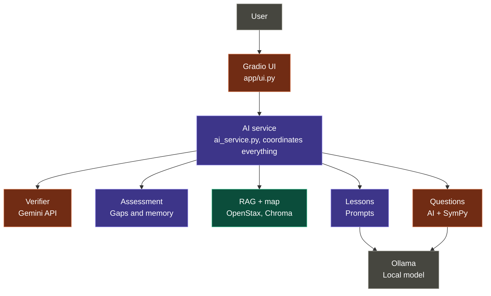

## Architecture and Responsibilities

Colors: 🟪 Eetu, 🟩 Lauri, 🟧 Fei

---

## Eetu: AI Service and Overall Structure

1. **Framework:** The entire flow runs using mock components in the actual files, allowing everyone to work on their own parts without waiting for each other.
2. **Assessment:** Rule-based, no AI. Start close to the goal and move down the map, with 2–3 questions per topic, an additional question if the result is unclear, and approximately 15–25 questions in total.
3. **Gap detection:** Each skill has a status: known / not known / not tested.
4. **Memory:** Progress and quiz scores are saved (JSON or SQLite), allowing the user to continue where they left off the next time.
5. **Progress through tests:** Each lesson is followed by a test. A skill is marked as mastered only after passing the test (e.g. 80%), and only then can the user continue to the next topic. If the user fails the test, they return to the material and receive a new test with new questions. Topics are covered from the bottom up on the map, meaning a topic becomes available only after its prerequisites have been passed. Once all gaps have been addressed, the goal is achieved.
6. **Lesson prompts:** Material is generated from RAG sources, and the source is visible to the user.
7. **Integration:** All components are connected through `ai_service.py`.

**Complete when:** The user selects "derivatives", completes the assessment, sees their knowledge gaps, and their progress is preserved after restarting the application.

---

## Lauri: Knowledge and Quality

1. **Books:** OpenStax books are downloaded from GitHub and converted into Markdown + LaTeX format. The books are not included in the repository; download instructions are provided in the README.
2. **Prerequisite map:** Approximately 60–80 skills (algebra → functions and trigonometry → limits → derivatives). Each has an ID, name, short description, and direct prerequisites. A powerful model creates a draft from the tables of contents. Check the contents against the tables of contents.
3. **RAG:** Books are split into chunks, each chunk is tagged with a skill from the map, and the chunks are stored in Chroma. Input: a skill or question. Output: source text + reference.
4. **Model comparison:** For example, Llama 3.2, Qwen3 8B, and DeepSeek-R1, using the same 5–10 mathematics prompts. Record correctness, clarity of explanations, and response time in a table in `project-decisions.md`.
5. **Evaluation:** Fill `test_cases.json` with successful, difficult, and error cases, and save the results in `evaluation_results.md`.

**Complete when:** A search for "chain rule" returns the correct sections, and the model choice is justified with numbers.

---

## Fei: Questions, Verification, and UI

1. **Question generation:** The local model generates questions and an answer key in an agreed format. Pydantic validation is used, with one retry if the format is invalid.
2. **SymPy:** Checks the user's answer mathematically (e.g. 2x + 2 = 2(x + 1), and comma → decimal point) and also checks that the AI's own answer key is correct.
3. **Verifier:** One Exteran AI API call after generation checks the lesson and questions against the sources. If the API does not respond, the material is displayed with an "unverified" label. The API key is stored in `.env`, never in the repository.
4. **UI:** Goal selection, assessment questionnaire, gaps, lesson, and quiz. The UI communicates only with `ai_service.py`.
5. **Testing:** Test question quality for your own component and improve prompts when necessary.

**Complete when:** A quiz is generated for one topic, its answer key is checked by SymPy, and it is approved by the external AI.
